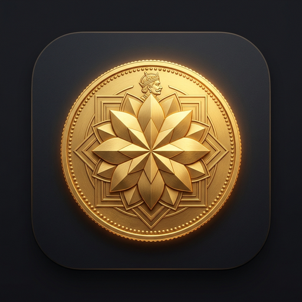
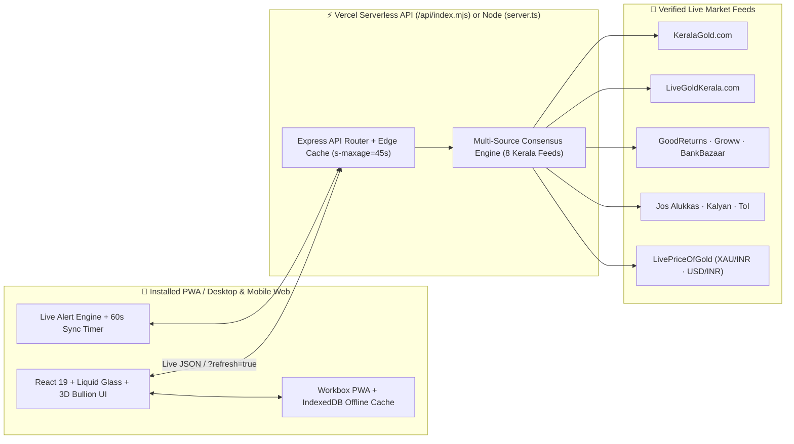

<div align="center">



# 🪙 Kerala Gold Price (KGP)

**Real-Time 22K Kerala Gold Tracker · Interactive 1925–Present History · Making Charge Calculator · Apple iPhone Shortcuts API**

*An installable, offline-first **Liquid Glass Progressive Web App (PWA)** with 3D metallic bullion cards, bilingual **English / മലയാളം** UI, 8-provider live consensus engine, and **one-click Vercel serverless deployment**.*

<p align="center">
  <a href="https://vercel.com/new/clone?repository-url=https%3A%2F%2Fgithub.com%2FDevarajankp%2Fkgp&project-name=kerala-gold-price&repository-name=kerala-gold-price">
    
  </a>
  &nbsp;&nbsp;
  <a href="https://devarajankp.github.io/kgp/">
    
  </a>
</p>

<p align="center">
  
  
  
  
  
  
  <a href="./LICENSE">
    
  </a>
</p>

</div>

---

> [!IMPORTANT]
> ### 🌐 Live Preview vs. Real-Time Deployment
> - **Interactive UI Demo (GitHub Pages):** **[https://devarajankp.github.io/kgp/](https://devarajankp.github.io/kgp/)** — Try the full UI, 3D bullion cards, jewellery making-charge calculator, share card studio, and 1925–Present history archives right in your browser.
> - **⚠️ Real-Time Sync Notice:** GitHub Pages is a **static file host** with no backend server, so live prices on the GitHub Pages demo **do not sync in real time** (browser CORS blocks direct website scraping and GitHub Actions cron schedules are throttled).
> - **⚡ Want Instant Real-Time Sync?** Click **[Deploy with Vercel](https://vercel.com/new/clone?repository-url=https%3A%2F%2Fgithub.com%2FDevarajankp%2Fkgp&project-name=kerala-gold-price&repository-name=kerala-gold-price)** above (or deploy to your own **Node.js / Render / Cloudflare** host) to launch your own free, private real-time instance in **~60 seconds**.

---

## ✨ Feature Highlights

| Module | What You Get |
| :--- | :--- |
| **⚡ Live Multi-Source Consensus** | Scrapes up to **8 verified Kerala gold providers** in parallel and promotes morning, noon, and afternoon intraday revisions automatically as soon as sources update. |
| **⏱️ Real-Time Sync Timer** | Live 60-second countdown sync timer on Vercel/Node deployments with instant tap-to-sync, tab-focus auto-refresh, and zero-stall edge caching. |
| **🔔 Instant Price Alerts** | Master ON/OFF switch with instant rate-change alerts (`🟢 ▲` rise / `🔴 ▼` drop for both **1 Pavan & 1 Gram**), daily updates, custom target thresholds (`≤` / `≥`), OS/Browser Push, and iPhone Shortcuts Lock-Screen alerts. |
| **🎨 Native App Experience & 3D Polish** | Fast 3D stamped **916 Sovereign Coin** opening splash, hardware-accelerated **3D perspective tilt bullion cards** with metallic light glare, rolling Fraunces price numerals, spring-animated tab indicators, and Day/Night Liquid Glass themes. |
| **📈 100+ Years of History (1925–Present)** | Daily month-by-month archives (`Nov 2009 – Present`), Monthly mid-month benchmarks (`2020 – Present`), and Yearly history (`1925 – Present`) with interactive SVG charts, instant search, and auto-pruning IndexedDB offline cache. |
| **🧮 Jewellery Making-Charge Calculator** | Auto-syncs live 22K / 24K / 18K rates; supports **Pavan & Gram**, `% / ₹ per gram / Flat` making charges, **GST**, **BIS HUID** hallmarking (`₹45`), stone charges, old-gold exchange deduction, and reverse budget weight estimation. |
| **📸 Custom Share Card Studio** | Exports crisp image-only PNG share cards (`Auto`, `9:16` WhatsApp/Instagram Status, `4:5`, `1:1`) with toggleable price chart & recent history, plus custom background photo crop/zoom/scrim cached locally. |
| **🌍 Bilingual (`EN / മലയാളം`)** | One-tap full interface switch between English and Malayalam across live rates, charts, alerts, calculator, and share cards. |
| **📱 Apple iPhone Shortcuts Ready** | Built-in flat JSON & plain-text API endpoints (`/api/gold/shortcut`, `/api/gold/alert-check`, `/api/gold/calculate`) for Lock-Screen notifications, Siri, and Home-Screen widgets. |

---

## 🏗️ System Architecture



---

## 🚀 Deploy Your Own Real-Time Instance

### Option 1: One-Click Deploy on Vercel (Recommended — Free & Real-Time)

This repository includes pre-configured **`vercel.json`** and **`api/index.mjs`** (built from `api/_entry.ts`) so both the **PWA frontend** and **real-time Express API** deploy together with zero configuration.

<p>
  <a href="https://vercel.com/new/clone?repository-url=https%3A%2F%2Fgithub.com%2FDevarajankp%2Fkgp&project-name=kerala-gold-price&repository-name=kerala-gold-price">
    
  </a>
</p>

**Or deploy manually from your fork:**
1. Fork this repository on GitHub.
2. Open **[vercel.com/new](https://vercel.com/new)** and import your forked repository.
3. Keep the auto-detected settings (`Framework: Vite`, `Output Directory: dist` — `vercel.json` handles `bun install`, serverless API bundling, and `/api/*` routing automatically).
4. Click **Deploy** — your private real-time app and live API are ready in ~60 seconds.

---

### Option 2: Self-Host Full Node.js Server (VPS / Docker / Render / Railway / Cloud Run)

Running `server.ts` directly enables **Server-Sent Events (SSE)** live streaming and **24/7 background VAPID Web Push** notifications in addition to all REST endpoints:

```bash
git clone https://github.com/Devarajankp/kgp.git
cd kgp
npm install --legacy-peer-deps
npm run build
npm start
```

- **Runtime:** Node.js `22+`
- **Build Command:** `npm install --legacy-peer-deps && npm run build`
- **Start Command:** `npm start` (serves on `PORT=3000` or platform `PORT`)
- **API Discovery:** `https://<your-domain>/api/openapi.json`

---

### Option 3: Static GitHub Pages Demo (UI Showcase Only)

1. Fork this repo → open **Settings → Pages → Source: GitHub Actions**.
2. Push to `main` or manually run **Actions → Deploy Kerala Gold Price PWA to GitHub Pages**.
3. *Note:* Static GitHub Pages serves pre-synced JSON snapshots and full historical archives, **not** real-time on-demand scraping. You can optionally link any deployed Vercel/Node API URL inside the app's **Alerts → Configure Server URL** panel to upgrade a static frontend to live sync.

---

## 🔌 REST API & Apple iPhone Shortcuts

When deployed to **Vercel** or a **Node.js server**, all endpoints support **CORS (`*`)**, input sanitization, and per-IP rate limiting (`120 req/min`):

| Endpoint | Method | Description |
| :--- | :---: | :--- |
| `/api/health` | `GET` | Runtime capabilities (`vercel-serverless` / `node-server`), version & providers |
| `/api/openapi.json` | `GET` | Full **OpenAPI 3.1.0** schema for external apps & SDKs |
| `/api/gold/latest` | `GET` | Live 22K/24K/18K Kerala rates, monthly log, high/low (`?source=&probe=true&refresh=true`) |
| `/api/gold/shortcut` | `GET` | Flat zero-nesting JSON (or `?format=text&lang=en\|ml`) for **Apple iPhone Shortcuts** |
| `/api/gold/alert-check` | `GET` | Dual-unit color-coded alert evaluator (`?target=96000&unit=pavan&direction=below&format=text`) |
| `/api/gold/history` | `GET` | Historical archives (`?mode=daily\|monthly\|yearly&year=2026&month=november`) |
| `/api/gold/spot` | `GET` | Live global `XAU/INR`, `USD/INR`, 24h % change, and day high/low |
| `/api/gold/sources` | `GET` | Live latency & health probe across all 8 Kerala providers |
| `/api/gold/calculate` | `GET` / `POST` | Live jewellery bill & reverse budget calculator (`?weight=2&unit=pavan&makingValue=10&gst=3`) |
| `/api/gold/stream` | `GET` | Real-time **SSE** push stream *(persistent Node server mode)* |

### 📱 Quick Apple iPhone Shortcut Setup (Using Your Own Vercel / Node URL)

1. Open the **Shortcuts** app on iPhone → tap **+** (New Shortcut).
2. Add **Get Contents of URL** → paste `https://<your-vercel-or-node-domain>/api/gold/shortcut?format=text&refresh=true` (add `&lang=ml` for Malayalam).
3. Add **Show Notification** (or **Show Result**) using the fetched text.
4. For automatic daily Lock-Screen alerts, create a **Personal Automation → Time of Day (9:45 AM & 4:00 PM)** pointing to `/api/gold/alert-check?format=text`.

---

## 🏦 Verified Data Sources

- **Primary Rate & Historical Archives (`1925–Present`):** [KeralaGold.com](https://www.keralagold.com/daily-gold-prices.htm)
- **Live Intraday Consensus & Fallbacks:** [LiveGoldKerala.com](https://www.livegoldkerala.com/), [GoodReturns.in](https://www.goodreturns.in/gold-rates/kerala.html), [Groww.in](https://groww.in/gold-rates/gold-rate-today-in-kerala), [BankBazaar.com](https://www.bankbazaar.com/gold-rate-kerala.html), [Jos Alukkas](https://www.josalukkasonline.com/gold-rate-today/kerala), [Kalyan Jewellers](https://store.kalyanjewellers.net/gold-rate/kerala/en), [Times of India](https://timesofindia.indiatimes.com/business/gold-rates-today/gold-price-in-kerala)
- **International Spot Market Context:** [LivePriceOfGold.com](https://www.livepriceofgold.com/india-gold-price.html) (`XAU/INR` & `USD/INR`)

---

## 🔒 Privacy, Security & License

- **Zero Tracking:** No analytics, no cookies, no user accounts, and no telemetry leave your device. See [SECURITY.md](./SECURITY.md).
- **Local-First Storage:** History cache, alert settings, and custom share card photos stay strictly on your device (`IndexedDB` / `localStorage`).
- **Open Source:** MIT Licensed ([LICENSE](./LICENSE)). Fetched bullion rates remain the informational property of their respective source publishers.

<div align="center">
  <sub>Built with React 19 · Vite 8 · Tailwind CSS v4 · Motion · Express · Cheerio · Workbox PWA</sub>
</div>
